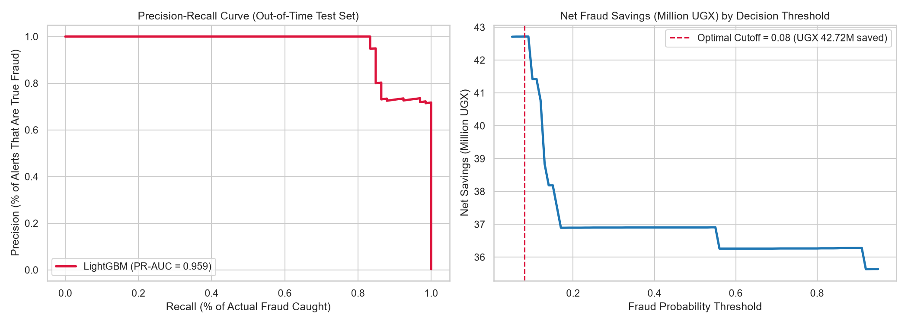
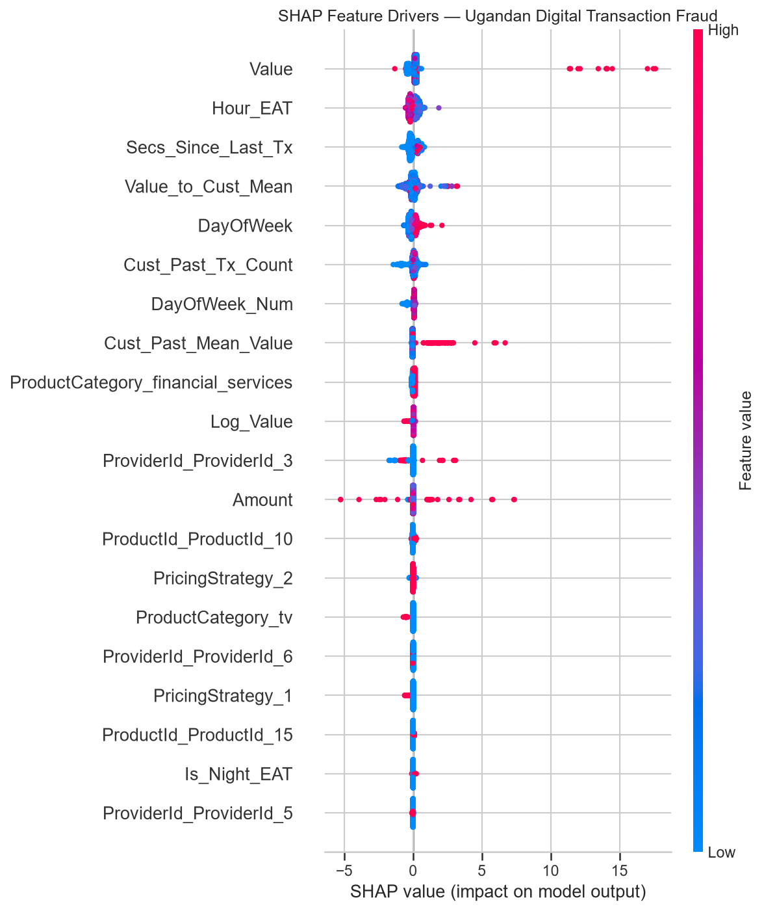

# 🛡️ Ugandan Digital Transaction Fraud Detection Engine

An end-to-end, time-aware fraud detection pipeline trained on **95,662 real Ugandan digital payment transactions** (Xente dataset), engineered for severe class imbalance (~0.2% fraud), UGX cost-benefit thresholding, and regulatory explainability.

## 📌 Business Context & Key Findings
In Uganda's mobile-first financial ecosystem, high transaction velocity and off-hour account takeovers pose major operational losses, while overly aggressive blocking creates customer friction.
- **Out-of-Time Validation:** Trained strictly on the earliest 80% of chronological transactions and evaluated on the unseen latest 20% (`19,133` transactions) to prevent future data leakage.
- **Model Performance:** Achieved **0.959 PR-AUC** (Precision-Recall AUC), catching **100% of test fraud cases (66/66)** at **72% precision** (`F1 = 0.84`) using a calibrated probability cutoff of `0.08`.
- **Financial Impact:** Estimated **UGX 42.72M net fraud savings** on the out-of-time test window (assuming UGX 650,000 average fraud loss vs. UGX 2,000 automated OTP verification cost).
- **Behavioral Insights:** Fraudulent activity clusters in high-value transfers (`Value`), late-night/early-morning East Africa Time (`00:00–06:00 EAT`), and sudden spend spikes relative to a customer's historical mean (`Value_to_Cust_Mean`).

## 📊 Model Evaluation & SHAP Explainability




## 📖 Dataset Variable Definitions (Xente Uganda)
| Column Name | Definition |
| :--- | :--- |
| `TransactionId` | Unique transaction identifier on the platform |
| `BatchId` | Unique number assigned to a batch of transactions for processing |
| `AccountId` | Unique number identifying the customer on the platform |
| `SubscriptionId` | Unique number identifying the customer subscription |
| `CustomerId` | Unique identifier attached to Account |
| `CurrencyCode` | Country currency (`UGX`) |
| `CountryCode` | Numerical geographical code of country (`256` — Uganda) |
| `ProviderId` | Source provider of item bought |
| `ProductId` | Item name being bought |
| `ProductCategory` | Broader category of `ProductId` (e.g., `airtime`, `financial_services`, `utility_bill`, `transport`) |
| `ChannelId` | Identifies if customer used web, Android, iOS, pay later, or checkout |
| `Amount` | Value of the transaction (positive for debits, negative for credits) |
| `Value` | Absolute value of the amount in UGX |
| `TransactionStartTime` | Transaction start time |
| `PricingStrategy` | Category of Xente's pricing structure for merchants |
| `FraudResult` | Target variable: Fraud status of transaction (`1` = Fraud, `0` = Legitimate) |

## 🛡️ Governance & Ugandan Regulatory Alignment
- **Chronological Integrity:** Past-only expanding windows (`cumsum` / `diff`) ensure zero look-ahead bias during feature generation.
- **Explainable Decisions:** Every flagged transaction surfaces its top 3 SHAP risk drivers and maps to a graduated step-up control (SMS OTP, velocity lock, or fraud desk callback), supporting auditability under Uganda's Data Protection and Privacy Act (2019).

## 🚀 Run Locally
```bash
git clone [https://github.com/YOUR_USERNAME/uganda-fintech-fraud-ml.git](https://github.com/YOUR_USERNAME/uganda-fintech-fraud-ml.git)
cd uganda-fintech-fraud-ml
pip install -r requirements.txt
streamlit run app.py